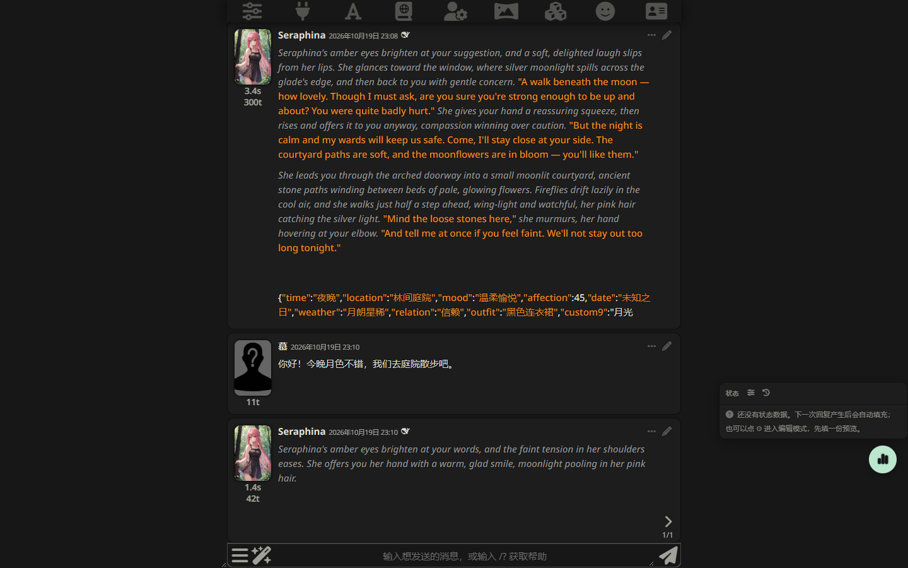
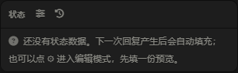

# SillyTavern 状态栏 (Status Bar)

> **这是我写的第一个酒馆插件。**
> 作为编程新人，代码难免有 bug 和不优雅的地方 —— 我自己用为主，遇到 bug 我会自己去修。
> 你也在用并且发现了问题，欢迎提 issue，但修不修、什么时候修，看我的进度 😄

为 SillyTavern 打造的沉浸式状态栏：模型每次回复会自动在末尾输出一段状态 JSON，插件负责解析、剥离、渲染 —— 你只需要正常聊天，就能看到随剧情更新的可视化状态面板。



*↑ 聊天末尾的简洁条 + 右侧悬浮窗，均为真实对话截图*

## 功能

### 双形态显示
- **简洁条**：贴在每条 AI 回复末尾的一行关键字段（时间 · 地点 · 心情 · 好感）
- **悬浮球 + 悬浮窗**：常驻小球点开完整面板，位置可拖动，图标可换



*↑ 悬浮窗：多字段 + 渐变进度条（好感低于 20% 会变红警告）*

### 字段完全自定义
- 字段的显示名、类型（文本 / 数字 / 进度条 / 标签）、图标、上限、排序都能改
- 内置 **167 个图标**的可视化选择器（按语义分组），不用背 FontAwesome 类名
- 「跟随心情」模式：心情字段的图标随模型写的情绪自动切换（疲惫 → 😪，心动 → 😍）
- 改坏了随时一键恢复默认

### 字段方案
内置 5 套一键切换的方案：**日常 / 身体状态 / 孕期 / 生理周期 / 战斗**，套用时可选整套替换或只补缺失字段。

### 多角色（最多 4 人）
- 模型按「角色名 → 字段」分组输出，状态栏按角色分列
- 顶部标签页切换：**全部**（概览，每人只显示核心字段）/ 点名字（单人全字段详情）
- 角色淡出剧情时状态保留，回归时以最新输出更新
- 超过 4 人自动淘汰最久未出现的

### 时效状态
- 值写成 `中毒(3)` 格式，每收到一条回复自动减一，归零自动消失
- 角色淡出期间照样倒数（人不在场，时间也在流逝）
- 在字段编辑器的「时效倒数」里开启

### 其他
- 历史快照回看：历史菜单列出所有带状态的楼层，点选即回看
- 配置导入 / 导出 JSON（换设备、同步手机）
- 提示词自动注入（深度、角色、格式均可调），回复里的状态块自动剥离
- 模型偶尔忘包标签直接输出裸 JSON？有兜底识别，照样解析

## 安装

前提：SillyTavern **1.13.0+**，已能正常连接一个聊天补全 API（DeepSeek / OpenAI / Claude 等均可）。

1. 打开 SillyTavern → 顶栏「扩展」面板
2. 在「Install extension」输入框粘贴本仓库地址：
   ```
   https://github.com/<你的用户名>/status-bar
   ```
3. 点击安装，等提示完成，**刷新页面**

手动安装（备选）：把仓库 clone 到 `data/default-user/extensions/status-bar/` 后重启酒馆。

## 使用

1. 随便和一个角色聊天，模型回复后消息末尾会出现简洁条，右下角出现悬浮球
2. 点球打开面板看完整状态；按住悬浮窗头部可以拖位置
3. 想改字段：点悬浮窗头部的 **⚙** 进入编辑模式
   - 上方一排**方案按钮**，一键套用整套字段
   - 或点「+ 自定义字段」，改个显示名就能用
   - 图标点行尾 `⋯` 里的选择器挑，心情类字段把「动态」设为「跟随心情」
   - 改完点「完成」
4. 想要时效效果：告诉模型「给角色加上中毒状态」之类，或自己在状态值里写 `中毒(3)`
5. 多角色：剧情里出现多个角色时自动生效，顶部标签切换查看

## 状态块格式（模型侧）

模型回复末尾自动输出（提示词注入已内置，无需手动管理）：

```
<status>
{"time":"傍晚","location":"书房","mood":"疲惫但放松","affection":42}
</status>
```

多角色时外层包角色名：

```
<status>
{"艾琳":{"time":"傍晚","mood":"疲惫"},"米娅":{"time":"傍晚","mood":"兴奋"}}
</status>
```

时效效果写成 `效果(剩余回合数)`，系统每回合自动倒数，归零消失。

## 已知限制

- 生成质量的下限取决于模型：小模型偶尔忘包 `<status>` 标签（有裸 JSON 兜底）、或干脆不输出状态（重新生成一次即可）
- 每次生成固定注入约 400 tokens（8 字段配置，DeepSeek 口径），字段越多越贵
- 手机端可用，但悬浮窗位置建议存一份竖屏配置

## License

MIT
